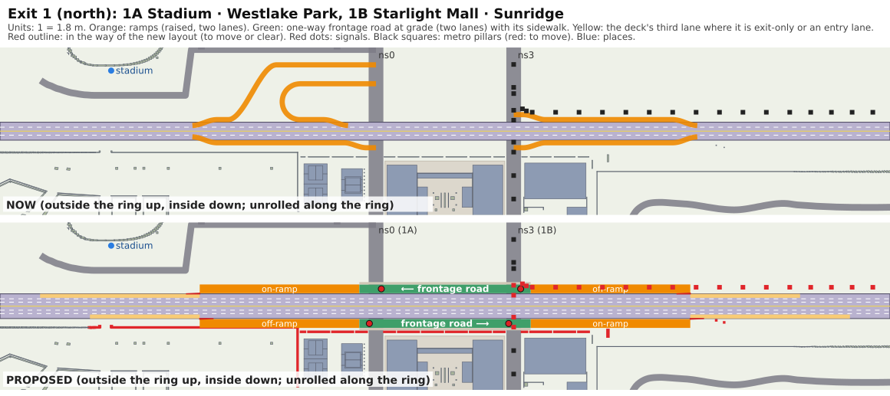
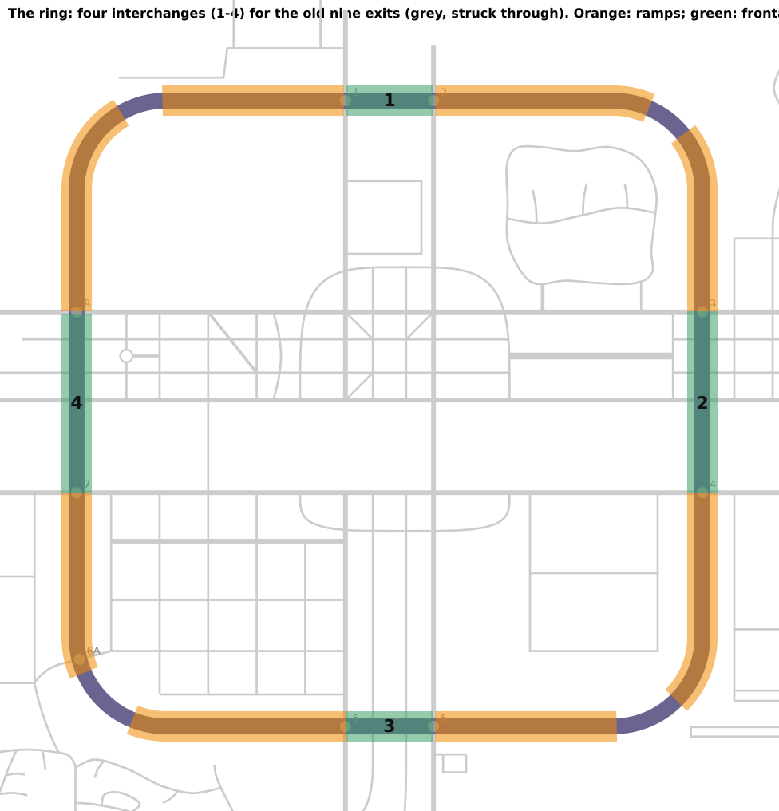
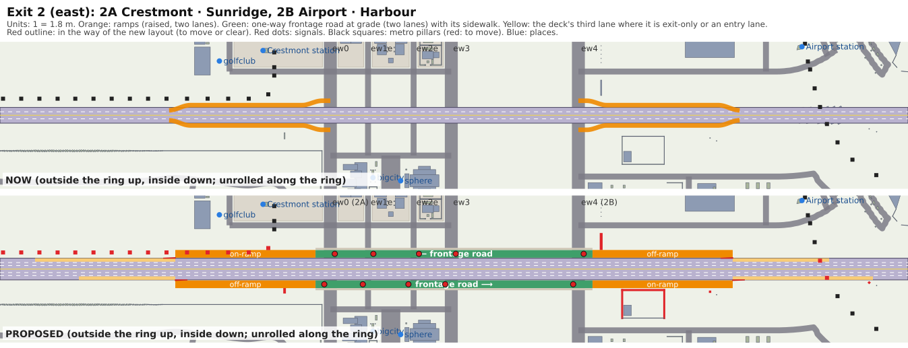
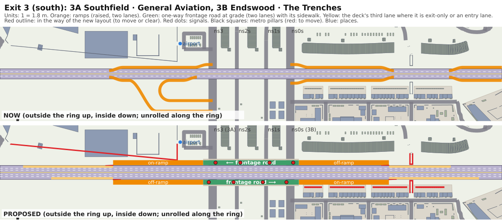
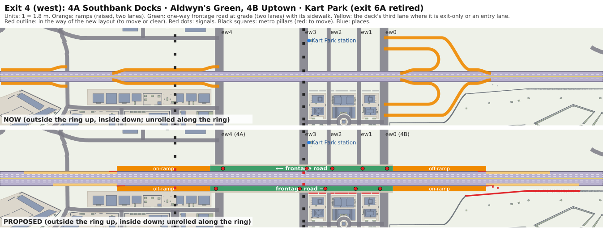

# Exits plan: the motorway's interchanges, realistic and roomy

**For the owner's sign-off.** Phase 0, the survey, is done: this file and its drawings (`docs/exits-shots/`, redrawn by
`npm run exits-fit`). Once the owner signs it off, the improvement loop builds it a phase a night
(`docs/improvement-loop-plan.md`), each phase small enough to merge on its own, or split into sub-steps when it isn't.
Keep this plan up to date.

## What the owner asked (2026-11-21)

From three screenshots of the exits: "the motorway exits are too narrow and some of the design doesn't work properly.
It needs to flow and have plenty of space." The motorway is a key component and the city can be built round it;
buildings may be deleted so the exits fit. "Look at real exits from real motorways and plan thoroughly to make a high
tech, well designed motorway exit and on-ramp system. Remove what you feel is necessary and add what you need."

The owner's picks: a **mix** (diamonds by default, big loops only where there's open land), **two-lane ramps**, **extra
deck lanes** to get on and off, buildings **deleted as needed** with owned lots refunded automatically, and the plan
signed off once, then built by the loop.

## What's there today

Nine exits (`viaduct.ts` `EXITS`, 6A's road `cornerroad.ts`) on a raised ring 1,840 units round (about 3.3 km). The
arterials cross the ring in four clusters, one on each side, 69 to 141 units across, and the exits sit in pairs inside
them: 69 units apart on the north and south sides (about 125 m), 141 on the east and west, with 6A 131 from exit 7.
Because a ramp couldn't climb between two crossings, every exit lays all its ramps on one side of its street, a
partial cloverleaf squeezed into a corner. In numbers (1 unit = 1.8 m, `TILE_M`; a lane is 1.7, a car about 2.4 long
and 1.0 wide):

| | Now | What makes it tight |
| --- | --- | --- |
| A ramp's width (`RAMP_HALF` 1.3) | 2.6 units (about 5 m): one narrow lane, walls both sides | about half a real one-lane ramp |
| A loop's radius (`QUAD`) | 9 units (16 m) | a real loop is at least 46 m: 3x tighter |
| Getting on (`QUAD.taper`, `SLIP.in`) | a 12-16 unit taper, then you're in the lane | a few car lengths to merge at speed |
| The climb (`RAMP_GRADE`) | 7% | short, steep ramps that need S-bends to fit |
| Where a ramp meets its street | an S-bend into a T, the lamps at the foot | no flare, no room to stop |

The screenshots show exactly this: the S-bends where a slip ramp leaves the deck and swings back to its street within
a few car lengths, the hairpin loops, a slip squeezed between a loop and the deck with nowhere to merge.

## What real motorways do

The standards used here are the US AASHTO "Green Book" (A Policy on Geometric Design of Highways and Streets, Chapter 10
Interchanges) as the state design manuals apply it, and the UK's DMRB CD 122 (geometric design of grade-separated
junctions) for the same ideas in British terms (auxiliary lanes, the nose, the merge and diverge). Lengths marked
"about" are rounded from the Green Book's tables (Exhibits 10-70 and 10-73); check the tables before quoting them
anywhere outside this plan.

**The scale.** The cross-section (lanes, shoulders, a ramp's width), the radii and the grades are what make an exit feel
roomy, so they stay close to real. The lengths along the road can't: the ring is 1,840 units round, its straight sides
350, and a real acceleration lane would fill a side. And the game's cars pick up and stop several times quicker than
real ones (`drive-sim.ts` `tune()`: 3-8 units/s² to pick up, 13 to brake), so they need far less length. The game
standard keeps lengths along the road at about half real.

| | Real | Real in game units | The game's standard |
| --- | --- | --- | --- |
| A lane | 3.6 m (12 ft) [1, 2] | 2.0 | **1.7**, the city's lane (the deck's and the streets', made for its cars) |
| A ramp's shoulders | 2.4 m outside, 1.2 m inside (8 ft and 4 ft) [1, 2] | 1.3 and 0.7 | **0.5 and 0.3** |
| A two-lane ramp | two lanes and both shoulders, about 11 m [2] | 6.1 | **4.4** across its parapets (today 2.6) |
| A loop's radius | at least 46 m (150 ft) for a 25 mph loop, the least on a motorway over 50 mph [3] | 25.5 | **25 or more** for any loop (today 9; this plan has none, below) |
| A ramp's curves | design speed about half to two-thirds of the motorway's [4] | | **60 units or more** where a ramp leaves or meets the deck (gentle reverse curves) |
| A deceleration lane | parallel, about 120 m plus a 75-90 m taper at 60 mph [4] | about 110 | **55**, its taper 15 |
| An acceleration lane | about 300 m plus its taper, 60 mph from a 25-30 mph ramp [4, 5] | about 165 | **80**, its taper 25 |
| A ramp's grade | 3-5% desirable, steeper only on slow ramps [4] | | **5% at most** (today 7%): a ramp is about 80 long to reach the deck |
| Clearance under the deck | 4.9 m (16 ft) [4] | 2.7 | **2.8** (`CLEARANCE`, as now) |
| Interchange spacing (urban) | 1 mile (1.6 km) at least; closer only with collector-distributor roads or braided ramps [6, 7, 8] | 894 | **one interchange a side** (about 460 apart), each with collector roads, and a continuous auxiliary lane between |
| Banking (superelevation) | up to 6-8% on ramps, 4-6% in towns [4] | | **4%** on ramp curves, **6%** on the ring's tight corners (radius 70: 126 m) |
| The gore | a painted chevron area before the physical nose, a crash cushion at the nose [4, 9] | | both, on every ramp |
| Two-lane exits | an exit-only lane plus an option lane [4] | | the deck's third lane exit-only, the second the option lane |
| Single-point interchange (SPUI) | one signal under the bridge, a small footprint, best for one cross street with room both sides [10, 11] | | not used: each side has two to five cross streets close together |

**Why not big loops (the owner's "mix").** A loop the standard allows (25 units, 46 m) takes a square about 70 x 70 units
beside the deck. The survey checked every quadrant (`npm run exits-fit`, and the counts below): every one has a
district in it within that reach (the mall and Uptown North, Crestmont's estates, the Neon Mile and Sunridge, The
Trenches, Endswood, the stadium's grounds, Uptown, the Docks' yards). And with frontage roads (below), every movement
is served without loops. So **no loops** in this plan; if the owner wants one as a showpiece later, the stadium's side
(north, outside) is the least built-up, a phase of its own.

## The design: one interchange a side, slip ramps and frontage roads

What real cities do where streets cross a motorway close together: the ramps don't meet each street. They come down to
a **one-way frontage road** (a collector road at grade) that runs beside the motorway past every cross street, with
signals at each, and climb back up from it after the last. A split diamond with collector roads, the usual answer
where interchanges are closer than the standard's mile [6, 7, 8]. Here it fits the ring's four clusters exactly.

- **The deck gets a third lane each way, all round** (`DECK_HALF` 4.5 to 6.2). On each carriageway the third lane is
  exit-only at an off-ramp, and an entry lane from an on-ramp. The gaps between one interchange's on-ramp and the
  next one's off-ramp are only 34 to 53 units at the corners, so the third lane runs on between them: an auxiliary
  lane, never a weave in two lanes.
- **Two-lane off-ramps**: the third lane exit-only, the second an option lane (stay on or leave). Deceleration lane
  55, a painted gore, a crash cushion at the nose. The ramp leaves the deck on a gentle curve, then descends at 5%
  beside it (about 80 units) to the frontage road.
- **The frontage road**: two lanes, one way with the carriageway above it, beside the deck (`o` 6.5 to 10.9 out from
  the centre line) with a sidewalk beyond. It crosses each street in its cluster at signals with turn lanes (the
  highway plan's Phase 6 turn lanes and arrows), so a driver can leave for any of them.
- **Two-lane on-ramps**: from the frontage road after the last street, climbing beside the deck, then an acceleration
  lane of 80 that becomes the third lane. **Ramp meters** at the foot of each on-ramp: a signal per lane that lets a
  car on every few seconds.
- **U-turn lanes under the deck** at each cluster's first and last street (Texas U-turns): from one frontage road to
  the other without a signal.
- **The high-tech kit**: smart gantries over the deck with a lane signal over each lane (a green arrow, a red X, a
  diagonal arrow to move over; never a number), advance signs and exit-only arrows painted in the lane, LED road
  studs along the lane lines and the gores that glow at night (small, so minimal bloom), CCTV masts, curve chevrons
  on the ring's corners. The sound walls, lamps and murals stay.
- **What it takes**: the strip beside the deck that the old ramps already use, about 2 units more. The new layout
  needs `o` up to about 13.6 (10.9, the sidewalk and 1.5 of clearance) within each interchange.

## The exits, before and after

Along the ring (`s`, clockwise from the middle of the north side); the spans are the clockwise carriageway's, from
the start of its deceleration lane to the end of its acceleration lane (the anticlockwise one mirrors it).

| New | Replaces | Streets it serves (at `s`) | Span | Signed |
| --- | --- | --- | --- | --- |
| **1, north** | 1 (ns0) and 2 (ns3) | ns0 (1805), ns3 (35) | 1662 to 203 | **1A** Stadium · Westlake Park, **1B** Starlight Mall · Sunridge |
| **2, east** | 3 (ew0) and 4 (ew4) | ew0 (380), ew1e (402), ew2e (428), ew3 (449), ew4 (522) | 237 to 690 | **2A** Crestmont · Sunridge, **2B** Airport · Harbour |
| **3, south** | 5 (ns3) and 6 (ns0s) | ns3 (885), ns2s (907), ns1s (933), ns0s (954) | 742 to 1122 | **3A** Southfield · General Aviation, **3B** Endswood · The Trenches |
| **4, west** | 7 (ew4), 8 (ew0) and 6A (Corner Road) | ew4 (1318), ew3 (1390), ew2 (1412), ew1 (1438), ew0 (1459) | 1175 to 1627 | **4A** Southbank Docks · Aldwyn's Green, **4B** Uptown · Kart Park |

**Exit 6A is retired.** It sat 131 units from exit 7, inside the west interchange's deceleration lane: a real
motorway would never put a ramp there. Corner Road keeps passing under the ring. Aldwyn's Green is reached from 3B
(Endswood) or from 4A by the Docks' ring road and Corner Road (Gate Hill). Keeping it would take a braided ramp (the
on-ramp passing over the next off-ramp), a phase of its own; not recommended.

Every district the old exits served is still served, and every street in a cluster now is (ew1e, ew2e, ew3, ns2s,
ns1s, ew1, ew2 and ew3 had no exit before).

## What has to move

The owner allowed buildings to be deleted. **None needs to be**: no place, lot, unit, pad or building of a district
stands in the new layout's way. The survey (`npm run exits-fit`, red outlines in the drawings) found:

- **The metro.** The Crestmont line runs beside the ring's outside on pillars at `o` 9.5 from `s` 39 to 345 (about 30
  pillars, the north and east interchanges' outside ramps run there): rebuilt as portal frames (a leg each side of
  the ramp and the frontage road, the track carried on the beam), or the line moved out past `o` 14. Where the main
  line and the branch cross the ring (`s` 35, 657-670, 1280, 1390), the pillars beside the deck (`o` 4.8 to 10.5) are
  re-spaced to clear the wider deck, the ramps and the frontage roads (a longer span over them).
- **General Aviation's fence** along the ring (south, outside, `o` 10.9, about 160 long): moved out to `o` 14. The
  hangar behind it (`o` 14) stays.
- **Westlake Gardens' boundary hedge** (north and west, inside, `o` 10.5, `s` 1527-1766): moved in about 3.
- **The Trenches' grit** by the ring (south, inside, `s` 968-1090: about 60 small props) and **Lot 9's fence posts**
  at `s` 1061: cleared or moved back.
- **A wall by the airport** (east, outside, `s` 535, `o` 11.3): moved.
- **Exit 6A's four slip ramps**, their piers, lamps and signs, and every old ramp: retired at the switch (Phase 7).
- Close but clear (the frontage road's sidewalk narrows a little there, nothing moves): Starlight Mall's south wall
  (`o` 16.0), Uptown North's podium (`o` 16.4), Uptown's west towers' podiums (`o` 16.3), The Trenches' tenements on
  the west side (`o` 14.5), Endswood's blocks on the south (`o` 17).
- Under the deck: the car parks, lock-ups, courts and murals stay (the wider deck is above them); the piers stay in
  the median with wider heads.

The owner's rule for anything owned stands: if a later change in a phase does take a lot or unit, the save refunds
it in full (a migration in `cleanSave()` with its test), with no prompt.

## What stays fixed

- The ring's line, its height (`DECK_Y`), the clearance under it and its corners; every street under it; every place,
  door, lot and unit (`tests/snapshot.test.ts` is rewritten on purpose at the switch for the ramps' streets and 6A's
  crossing only, the owner's call in this plan).
- Made-up names on every sign (the exits' destinations are the districts' own names); no numbers but the exits'
  labels; no speed limits.
- Phones stay light: the new ramps are 16 straight runs where the old were 20 mixed loops and slips; drawn through
  sites and Batches, the studs and the meters instanced and near only. Measured with `?bench hw-exit` (and new views,
  one per interchange) before and after; the budgets (`scripts/budget.mjs`) not raised.
- Rules apart from the drawing: the new layout is DOM-free data with tests; the drawing only draws it.

## Phases

Each phase merges on its own and leaves the city working; the new interchanges are built behind a switch (`?exits=new`
in the address, read in one place) and turned on for everyone in Phase 7. A phase too big for one night is split into
lettered steps, each merged.

0. **The survey** (done, 2026-11-21): this plan, the drawings, `scripts/exits-fit.mjs`. For the owner's sign-off.
1. **The standard as rules and tests.** `exitstd.ts` (DOM-free, on `DOM_FREE`): the standard's numbers (the table
   above) and `checkRamp()` / `checkInterchange()`, which report every breach (width, grade, lengths, radius,
   clearance to solids, streets and pillars, the gaps between interchanges). Tested on hand-made ramps. Nothing in the
   city changes.
2. **The new interchanges as data, behind the switch.** `exits2.ts` (DOM-free): the four interchanges (the deck's
   lanes, the two-lane ramps and their heights, the frontage roads as one-way streets with their signals, the gores,
   the U-turn lanes). Tests: every ramp meets the standard; every movement works (from each street in a cluster onto
   each carriageway and off it again, through the route graph); what still clashes is listed in the test until
   Phase 5 moves it. 2a the north interchange and the shape of the data; 2b the other three.
3. **The deck widened to three lanes each way** (live: the old ramps follow it out, since they're placed from
   `DECK_HALF`). The deck's drawing, the piers' heads, parapets, median, lamps, gantries and sound walls, its walls
   and camera (`viaground.ts`, `DECK_CAMERA`), the traffic on three lanes (`RING_ROUTES`). 3a the data and its tests,
   3b the drawing, 3c the traffic. Measured on `?bench hw-straight` and `hw-exit`.
4. **The new interchanges drawn, behind the switch**, one a night: 4a north, 4b east, 4c south, 4d west. The ramps
   (box girders on piers where high, a filled bank where low, as `rampSegs()` does now), the frontage roads at grade
   with their kerbs, sidewalks and lamps, the gores' chevrons and crash cushions, lane markings (exit-only arrows,
   the option lane), the signals, the U-turn lanes under the deck.
5. **Clearing the way** (live): the Crestmont line's pillars as portal frames (or the line moved out), the crossings'
   pillars re-spaced, the General Aviation fence and Westlake Gardens' hedge moved, the grit and Lot 9's posts
   cleared. The metro's own tests hold; nothing in the snapshot moves.
6. **Traffic, taxis, walking and driving, behind the switch.** The street plan takes the new ramps and frontage roads;
   the routes get the diverge and the third lane (`merge` and a new `diverge` turn), the signals' phases, the ramp
   meters (cars wait their turn); taxis take the quickest way through them; walking keeps off the ramps (`walkOff()`)
   and walks the frontage roads' sidewalks; the ramps are ground by height and walled (`viaground.ts`). 6a the routes
   and lights, 6b taxis and walking, 6c driving: banking on the ramps' curves (4%) and the ring's corners (6%) in
   `drive-sim.ts`, the smoke run driving through each interchange.
7. **The switch, signs and the high-tech kit.** The new interchanges on for everyone; the old ramps, 6A, their piers,
   lamps and signs retired; the exits renumbered on the signs and the world map (`EXIT_SIGNS`, `GANTRIES`,
   `exitBadge()`); the smart gantries, the LED studs, CCTV masts and curve chevrons; the snapshot rewritten on purpose
   (`UPDATE_SNAPSHOT=1 npm test -- snapshot`); `docs/guide/highway.md` rewritten. 7a the switch and the retirements,
   7b the signs and the kit.
8. **Polish and performance.** `?bench` views for each interchange; the phone tier's draws the same as or lower than
   today's `hw-exit`; the review shots by day and at night; the widths and phones turned sideways for any card;
   `npm run smoke`; this plan closed with what it measured.

## Risks

- **The traffic's routes** are baked (`routes.ts`, `scripts/bake.mjs`) and the routes test is the slowest in the
  suite: the new ramps and frontage roads change every route that used the ring. The route graph test in Phase 2 and
  the `?bench` traffic view guard it; the switch keeps the old routes live until Phase 7.
- **Taxis** (`taxi.ts`) take the quickest way (`HIGHWAY_PACE`) and must never stop on a ramp or the deck: the new
  frontage roads have signals, the ramps don't.
- **The metro** rises over the ring and its ramps (`metro.ts` `trackY()`, `PLATEAUS`); its pillars move in Phase 5 and
  the train's height over the new ramps is checked (`CLEARANCE` over the highest ramp).
- **The snapshot** is rewritten once, on purpose, in Phase 7, for the ramps' streets and 6A's crossing; nothing else in
  it may change. If anything else shows up in its diff, stop and fix the code.
- **Saves**: nothing owned moves (checked); the refund migration is written only if a phase finds otherwise.
- **Performance**: a wider deck is more area but not more draws; the frontage roads are street-level asphalt, kerbs
  and lamps through the same kits as every street. Measured each phase; the budgets aren't raised.
- **The ring's corners** stay tight (radius 70, about 126 m: a real motorway at this speed wants several times that).
  Banking and curve chevrons help; reshaping the ring is out of this plan.

## The owner's decisions (2026-11-21)

- Exits that flow and have plenty of space; the motorway is a key part of the city and can be built round.
- Ramps: **two lanes**. Getting on and off: **extra lanes on the deck**. Layout: **a mix** (diamonds by default, loops
  only on open land; the survey found none open, so none).
- Buildings: **deleted as needed**, owned ones refunded automatically (none needed, the survey found).
- The number of exits: **what's realistic** (four interchanges with lettered exits; 6A retired).
- Built by the loop after one sign-off of this plan.

## To confirm at sign-off

1. Four interchanges with lettered exits (1A to 4B) in place of nine numbered ones, 6A retired.
2. The U-turn lanes under the deck, and ramp meters on every on-ramp.
3. The Crestmont line beside the ring: portal frames over the new ramps (recommended), or the line moved out.

## Sources

1. Wyoming DOT, Road Design Manual 7-05 (ramps: 12 ft lanes; 4 or 8 ft outside shoulders; Green Book Tables 10-5 and
   10-6 for speed-change lanes): https://www.dot.state.wy.us/files/live/sites/wydot/files/shared/Project%20Development/Road%20Design%20Manual_1/7-05%20(May23).pdf
2. Texas DOT, Roadway Design Manual 9.4.3 and 15.7.5, ramp and direct connector lane and shoulder widths:
   https://www.txdot.gov/manuals/des/rdw/chapter-9--mobility-corridor-facilities--5r-/9-4-ramps-and-direct-connectors/9-4-3-lane-and-shoulder-widths.html
3. North Carolina DOT, Roadway Design Manual ch. 8 Interchanges (a loop no less than 25 mph, 150 ft radius, on
   highways over 50 mph): https://connect.ncdot.gov/projects/Roadway/Roadway%20Design%20Manual/08.%20Interchanges.pdf
4. AASHTO, A Policy on Geometric Design of Highways and Streets (the Green Book), 7th ed. 2018, ch. 10 Interchanges
   (Exhibits 10-70, acceleration lengths, and 10-73, deceleration lengths); FHWA's interchange design prompt list:
   https://highways.fhwa.dot.gov/sites/fhwa.dot.gov/files/interchange_design_promptlist.pdf
5. NCHRP, the Green Book's acceleration lengths reviewed: https://nap.nationalacademies.org/read/26415/chapter/3
6. Caltrans, Highway Design Manual ch. 500 (one mile between interchanges in towns):
   https://dot.ca.gov/-/media/dot-media/programs/design/documents/chp0500-032020.pdf
7. WSDOT, Design Manual 1360 (1 mile in towns; closer with C-D roads or braided ramps):
   https://wsdot.wa.gov/publications/manuals/fulltext/M22-01/1360.pdf
8. Texas DOT, Roadway Design Manual 15.6 (1 mile desirable; braided ramps or C-D roads where closer):
   https://www.txdot.gov/manuals/des/rdw/chapter-15-grade-separations-and-interchanges-/15-6-general-design-considerations.html
9. National Highways, DMRB CD 122 Geometric design of grade separated junctions (auxiliary lanes, the nose):
   https://www.standardsforhighways.co.uk/tses/attachments/a09ef1dc-15dd-4c42-9c0a-88131ee9b103
10. MoDOT, Engineering Policy Guide 234.4, Single Point Urban Interchanges: https://epg.modot.org/index.php/234.4_Single_Point_Urban_Interchanges_(SPUIs)
11. Kentucky Transportation Cabinet, SPUI: https://transportation.ky.gov/saferoadsolutions/Pages/SPUI.aspx
