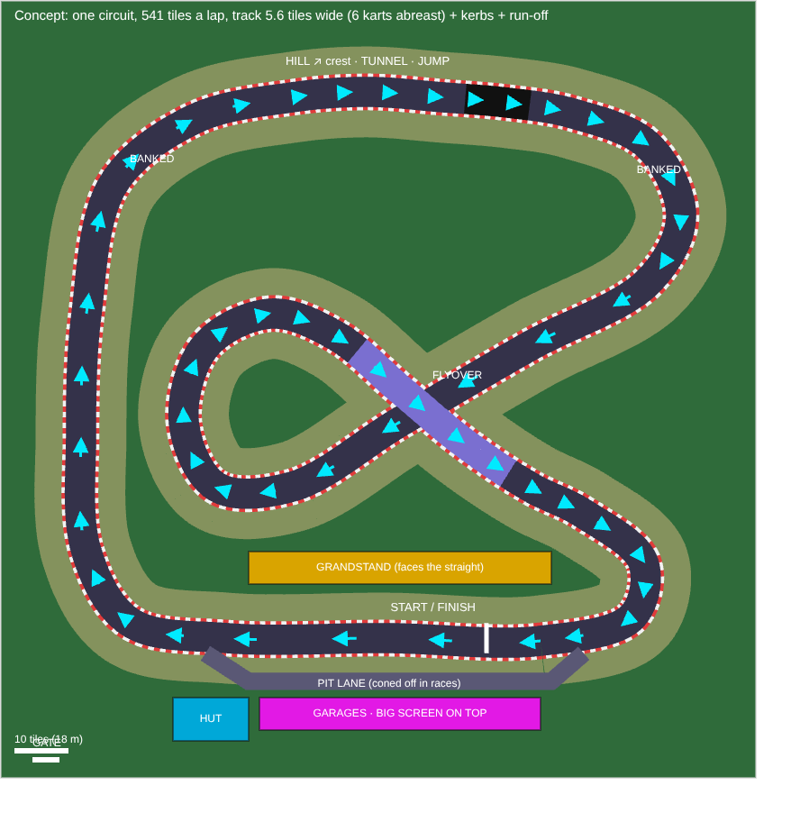

# The kart park rebuild: the plan

The owner's call: the kart park's track is the wrong scale, has things to
bump into and gets confusing round the pits. Rebuild it as one clear,
narrower circuit with nothing solid on or near it, a proper pit lane on the
start straight, and pure racing (no items). Built in phases, each signed
off by the owner before the next starts.

## What the owner asked for

- **Scale:** the track is 10.4 tiles wide today (about 11 karts abreast).
  Narrow it to **5.6 tiles** (6 karts abreast), with kerbs and run-off.
- **Layout:** **one circuit** with no forks or junctions anywhere, raced
  forward and reverse. The six-sector network, its four junctions and the
  Neon Loop / Summit Run / Grand Circuit go.
- **Kept features:** banked bends, a **flyover** (the loop crosses over
  itself once, open underneath), and a **hill with a tunnel and a jump**.
  The wet patch and the dirt shortcut go.
- **Lap:** medium. The concept below measures about 540 tiles, roughly 45
  seconds at Sport pace (it will be timed by the sim's own driver and can
  be trimmed towards 40 s if the owner wants).
- **Nothing solid on or near the track:** no pillars, posts or walls. In a
  race there are no invisible walls either: the run-off (grass and gravel)
  slows you, and going far off puts you back on the track. Only the outer
  fence, the hut, the garages and the grandstand are solid, all well clear
  of the run-off.
- **Track edge:** red-and-white kerbs, a strip of grass and gravel run-off,
  tyre stacks set well back as scenery (not solid).
- **Pits:** everything on the start/finish straight. The grandstand faces
  it from the infield; across the straight, the pit lane with a garage per
  kart, the hut at its end and the big screen on the garages' roof. The
  gate path leads straight there. Races start from a grid on the straight;
  the pit lane is coned off during a race.
- **Racing:** pure racing. No item boxes and no items (rocket, oil, gummy,
  pigeon, shield, trail); seven rivals, drifting, drift boosts, boost pads
  and the hump's air stay, re-tuned for the narrower track.
- **Cups:** each is still four races, mixing forward and reverse, lap
  counts, a **night race** and a **rain race**. Old lap records and boards
  are put away (they were set on a different track); karts, mods, trophies,
  Dorras and XP all stay.
- **Knowing where to go:** a **minimap** in the HUD with every kart's dot,
  **chevron boards** on the outside of bends and **arrows** painted before
  turns, **numbered corner boards** and **3-2-1 braking markers** before the
  hard corners.

## The concept

One loop in the park's local numbers (u east, v south, 136 x 140), raced
forward like this:

1. The start/finish straight runs west along the south, the grandstand on
   its north side, the pit lane and garages on its south side.
2. Turn 1, a right-hander, up the west straight.
3. A banked right sweeper in the north-west corner.
4. The hill along the north: up to a crest, down through the tunnel, over
   the jump.
5. A banked right sweeper in the north-east corner.
6. Into the diagonal across the middle at ground level, round the west
   loop (a long right-hander in the infield).
7. Back across the middle on the flyover, over the first diagonal.
8. A right-hander in the south-east onto the straight.

Reverse runs it the other way round (every corner flipped, the flyover
before the west loop).

Numbers from the concept: 540 tiles a lap; the tightest corner has a
radius of 6.4 (the south-east turn onto the straight); away from the
flyover no part of the track comes within about 17 tiles of another; the
flyover's deck is 2.6 over the diagonal below.

## Build order

1. **The circuit as data** (built: `kartcircuit.ts`, DOM-free, tested in
   `tests/kartcircuit.test.ts`; the drawing from its data is
   `kart-circuit.png`). It sits beside the old network in `kartpark.ts`
   (sharing the site, the local numbers and the sampling) so the park
   keeps running until Phases 2 and 3 move onto it; the old network goes
   then. The owner asked for more corners and less straight road than the
   concept, so as built it has twelve, lefts and rights: Turn 1, the west
   esses (2, 3), the banked north-west sweeper (4), the hill dipping south
   over its crest and back (5, 6) before the tunnel and the jump, the
   banked north-east sweeper (7), a right hairpin (8), a long double-apex
   left (9, 10) back into the infield, the west loop (11) and the
   south-east turn onto the straight (12). 589 tiles a lap (longer than the
   concept's 540; it can be trimmed once the sim times it), the tightest
   corner radius 6.3 (the hairpin), the flyover 2.6 over the run below, the
   hill's crest 3, the banked sweepers at 0.28, the run-off 8 from the
   centre line, the start line at u 84 with the grid behind it on the
   straight, the pit lane in before the line and out before Turn 1, the hut
   at its west end, the grandstand in the infield; corners numbered from
   the line in each direction.
   - One closed line (centripetal Catmull-Rom like today) with heights,
     banking and flags (deck, tunnel, bank), the track 5.6 wide, kerbs and
     run-off widths, the start line, the grid on the straight, the pit lane
     (entry, exit, the garages' bays), the hut, garages, grandstand and
     screen, the gate path. Forward and reverse courses.
   - Solids: only the fence (gate open), the hut, the garages and the
     grandstand (`KART_SOLIDS`); the gantry's posts and the flyover's
     supports stand outside the run-off and aren't solid. Your own kart
     and car still ride the track's surface off a race
     (`trackSurfaceAt()`).
   - Tests (`tests/kart.test.ts`, rewritten): no corner tighter than about
     6; ramps under slope 0.3; the track never within its width plus
     run-off of itself except where the flyover crosses it, and there at
     least `BRIDGE_H` over it; every solid clear of the track and run-off;
     the grid and pit lane on and off the track as they should be; the lap
     in its range.
2. **The racing rules** (`kart-sim.ts`, DOM-free, seeded, tested).
   - Items out: the boxes, the six items, the roulette and their events.
   - No walls: the run-off's grip and speed cap slow you; beyond it you're
     put back on the track (a brief fade, the place you'd reached, no
     prize lost).
   - Rivals on the new racing line (look-ahead, braking for the narrower
     corners, drifting); boost pads placed for the new corners; the hump's
     air on the jump.
   - Conditions: a night race (looks only) and a rain race (less grip all
     round, rain on). Cups of four races each from forward / reverse,
     lap counts and conditions; par laps timed by the sim's own driver.
   - The save (v8): old records and boards are put away; karts, mods,
     trophies, Dorras, XP and counters stay. The two item-based goals (the
     "Pigeon post" mission and the "Pigeon fancier" badge) are replaced by
     racing ones (proposal: clean laps without leaving the track, and
     overtakes); the Nitro kit's blurb loses the rockets.
3. **Drawing it** (`kartpark3d.ts`).
   - The narrower ribbon with red-and-white kerbs, grass and gravel
     run-off, tyre stacks set back, the banked bends, the hill, the tunnel,
     the jump, the flyover deck (open underneath), the start gantry and grid
     boxes, the pit lane with cones, the garages (your kart in its bay),
     the hut, the grandstand with its crowd, the big screen on the garages.
   - Guidance: chevron boards on the outside of bends, arrows painted
     before turns, numbered corner boards and 3-2-1 braking markers.
   - Draw calls at or under today's at the park (measure with `?fps`).
4. **The HUD and the hut** (`kart.ts`, `kart-ui.ts`, `karts.css`).
   - The minimap (the circuit's outline, every kart's dot, yours lit); the
     item slot and the touch Item button go.
   - The hut's menu: the cups, single races (forward / reverse, night,
     rain), time trials with their ghosts, the daily challenge, the karts,
     the boards for the new track.
   - Check at 320, 375, 768, 1024 and 1440 wide, upright and on its side,
     day and night, on the phone tier.

Each phase gets the owner's sign-off before the next one starts.
